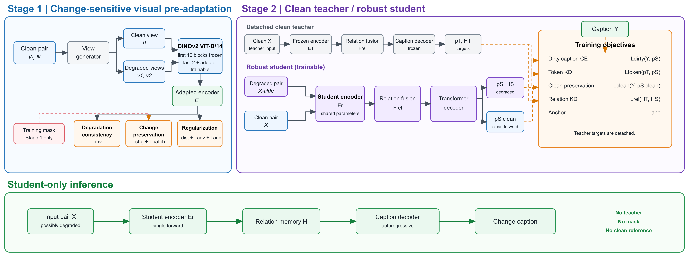

# Partial-RelKD

Research-code release candidate for robust remote-sensing change captioning under
leave-one-degradation-family-out (LOFO) evaluation.

Partial-RelKD keeps the original task unchanged: a possibly degraded
bi-temporal image pair is mapped to a natural-language change caption. The
method has two training stages:

1. **Change-sensitive visual pre-adaptation.** The last two DINOv2 ViT-B/14
   blocks and a residual adapter are optimized with degradation consistency,
   change preservation, feature distillation, adversarial degradation
   regularization, and an anchor loss. Ground-truth change masks are used only
   in this training stage.
2. **Clean-teacher / degraded-student caption training.** A frozen clean branch
   supplies token-distribution and bi-temporal relation-memory targets. The
   trainable student receives degraded and clean views with shared parameters.

Inference uses only the student encoder, relation memory, and caption decoder;
it requires no teacher, mask, clean reference, or degradation label.



## What is included

```text
research_code/
  dino_finetune_step1/              # Stage-1 DINOv2 adaptation implementation
  stage4_caption_dino_finetune/     # clean caption-teacher preparation/training
  stage6_5_calibrated_v3/           # calibrated-v3 online degradation operators
  stage6_6_m2_backbones/            # strict-LOFO Stage-1 and DINO-Aug controls
  stage6_7_partial_hybrid/           # P1/P2/P3 and 31-condition evaluation
  stage8_1_multidataset_full/       # target-supervised SECOND-CC/WHU-CDC runs
  stage8_2_dino_controls/            # DINO-Clean and DINO-Aug controls
  stage8_4_levir_multiseed_server/  # DINO-Aug/P3 training-seed stability
  stage10_2_paired_significance/    # P3 vs DINO-Aug clustered Bootstrap
  stage10_3_p3_nomask/              # independently retrained mask-free lineage
  stage10_5_p0_p2_nomask/           # mask-free P0/P1/P2 ablations
  stage10_7_severity_curves/         # severity 1--5 evaluation
  stage10_8_main_completion/         # full-family, seed, efficiency, mask-free extension
  stage10_authoritative_baselines/  # baseline wrappers (vendor code excluded)
  stage10_9_three_dataset_baselines/# three-dataset baseline wrappers
reported_results/                    # compact canonical summaries only
tools/                               # release audit and path materialization
```

Raw datasets, pretrained weights, trained checkpoints, feature caches,
per-sample predictions, logs, and third-party repositories are intentionally
excluded. See [DATASETS.md](DATASETS.md) and [THIRD_PARTY.md](THIRD_PARTY.md).

## Important: materialize paths before running

The audited research scripts originally ran in a fixed server layout. In this
release, machine-specific prefixes are replaced by four explicit tokens:

- `__PROJECT_ROOT__`
- `__DATA_ROOT__`
- `__CHANGE_AGENT_ROOT__`
- `__WORK_ROOT__` / `__STORAGE_ROOT__`

Do not execute files directly under `research_code/`. Generate a runnable copy:

```bash
python tools/materialize_workspace.py \
  --output /path/to/robust_cc/project \
  --data-root /path/to/robust_cc/data \
  --change-agent-root /path/to/Change-Agent/Multi_change
```

The command refuses to write into a non-empty output directory. It copies the
research stages and substitutes all path tokens, leaving the tracked templates
unchanged.

## Reproducing the main geometry-quality protocol

The primary protocol excludes `blur`, `low_resolution`, `misregistration`, and
`mixed` from training, validation, early stopping, and checkpoint selection.
The six allowed training degradations are `cloud`, `haze`, `gaussian_noise`,
`jpeg`, `pixel_dropout`, and `radiometric_shift`.

After materialization:

1. Train the strict-LOFO Partial-last2 encoder with
   `stage6_6_m2_backbones/runner/run_dino_lofo.py`.
2. Prepare clean encoder features and train the clean caption teacher using
   `stage4_caption_dino_finetune/runner/prepare_features.py` and
   `train_caption.py`.
3. Train P1/P2/P3 with `stage6_7_partial_hybrid/runner/train.py`. The main model
   is `configs/p3_partial_relation.json`.
4. Evaluate clean plus all 30 degraded conditions with
   `stage6_7_partial_hybrid/runner/evaluate.py`.

The exact commands and hyperparameters remain in the README and JSON files of
each stage. The standard test setting is severity 2 with degradation seed
`20260928`.

## Verification before upload or execution

```bash
python tools/audit_release.py
python tools/smoke_test.py
python -m compileall -q research_code tools
```

The audit checks for large/binary artifacts, private paths, common credential
patterns, unresolved non-template path leakage, and missing core files. The
data-free smoke test checks path materialization and all ten deterministic
online degradation operators. It does not claim model inference, which needs
the externally supplied datasets, upstream code, and checkpoints documented
above.

## Evaluation scope

- Main metrics: BLEU-4, ROUGE-L, and CIDEr using the same implementation across
  compared models.
- Main benchmark: LEVIR-MCI under three strict full-family LOFO protocols.
- Additional datasets: SECOND-CC and WHU-CDC, independently trained with each
  dataset's own images, captions, vocabulary, and splits.
- Stress tests: clean, seen, unseen, mixed, severity 1--5, multiple training
  seeds, multiple degradation seeds, and paired clustered Bootstrap where
  aligned per-sample predictions are available.

## Release status

This folder is a public-release candidate. Before making it public, run a
clean-clone smoke test and verify the submitted-paper numbers against
`reported_results/`. No explicit repository license is currently granted.
Author and citation metadata may remain anonymous until the venue's
double-blind period ends.
