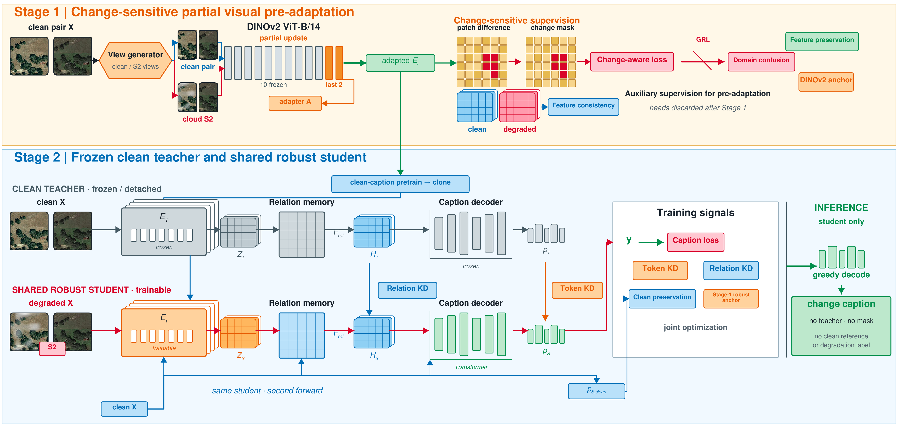

# Partial-RelKD

Research-code release for robust remote-sensing change captioning under
leave-one-degradation-family-out (LOFO) evaluation.

Partial-RelKD keeps the original task unchanged: a possibly degraded
bi-temporal image pair is mapped to a natural-language change caption. The
method has two training stages:

1. **Change-sensitive visual pre-adaptation.** The last two DINOv2 ViT-B/14
   blocks and a residual adapter are optimized with degradation consistency,
   change preservation, feature distillation, adversarial degradation
   regularization, and an anchor loss. Ground-truth change masks are used only
   in this training stage.
2. **Clean-teacher / degraded-student caption training.** A frozen clean branch
   supplies token-distribution and bi-temporal relation-memory targets. The
   trainable student receives degraded and clean views with shared parameters.

Inference uses only the student encoder, relation memory, and caption decoder;
it requires no teacher, mask, clean reference, or degradation label.



## What is included

```text
partial_relkd/                      # reusable method components
  models/visual_adapter.py          # partial DINOv2 adaptation, adapter, and GRL
  data/degradations.py              # calibrated-v3 online degradations
  losses/distillation.py            # caption CE, token KD, and relation KD
configs/                            # concise public configuration entry points
scripts/                            # train/evaluate command wrappers
baselines/wrappers/                 # interfaces for seven comparison baselines
experiments/legacy_stages/          # exact validated stage drivers and ablations
reported_results/                   # paper-aligned canonical summaries
docs/                               # method and severity figures
tools/                              # workspace materialization and data-free smoke testing
```

Raw datasets, pretrained weights, trained checkpoints, feature caches,
per-sample predictions, logs, and third-party repositories are intentionally
excluded. See [DATASETS.md](DATASETS.md) and [THIRD_PARTY.md](THIRD_PARTY.md).

Install the public package and main dependencies with:

```bash
pip install -r requirements.txt
pip install -e . --no-deps
```

## Set up a runnable workspace

The training and evaluation scripts require local paths to the datasets and the
Change-Agent components. After cloning this repository, create a runnable
workspace by providing these paths:

```bash
python tools/materialize_workspace.py \
  --output /path/to/robust_cc/project \
  --data-root /path/to/robust_cc/data \
  --change-agent-root /path/to/Change-Agent/Multi_change
```

Arguments:

- `--output`: an empty directory in which the runnable experiment workspace
  will be created;
- `--data-root`: the directory containing the datasets described in
  [`DATASETS.md`](DATASETS.md);
- `--change-agent-root`: the local Change-Agent `Multi_change` directory,
  including its caption decoder, evaluation code, and LEVIR-MCI metadata.

The command creates the experiment directories, copies the public
`partial_relkd` package and configurations, and resolves local path
placeholders. It does not copy datasets, pretrained weights, or third-party
repositories.

The output directory must be empty to avoid overwriting existing files.

After setup, the concise command wrappers can be used to launch the validated
experiment drivers. For example:

```bash
python scripts/train_partial_relkd.py \
  --workspace /path/to/robust_cc/project \
  -- \
  --config /path/to/robust_cc/project/configs/stage2/partial_relkd.json \
  --output /path/to/robust_cc/project/stage6_7_partial_hybrid/runs/p3_partial_relation
```

Dataset preparation and third-party dependency requirements are documented in
[`DATASETS.md`](DATASETS.md) and [`THIRD_PARTY.md`](THIRD_PARTY.md).

## Reproducing the main geometry-quality protocol

The primary protocol excludes `blur`, `low_resolution`, `misregistration`, and
`mixed` from training, validation, early stopping, and checkpoint selection.
The six allowed training degradations are `cloud`, `haze`, `gaussian_noise`,
`jpeg`, `pixel_dropout`, and `radiometric_shift`.

After materialization:

1. Train the strict-LOFO Partial-last2 encoder with
   `stage6_6_m2_backbones/runner/run_dino_lofo.py`.
2. Prepare clean encoder features and train the clean caption teacher using
   `stage4_caption_dino_finetune/runner/prepare_features.py` and
   `train_caption.py`.
3. Train P1/P2/P3 with `stage6_7_partial_hybrid/runner/train.py`. The main model
   is `configs/p3_partial_relation.json`.
4. Evaluate clean plus all 30 degraded conditions with
   `stage6_7_partial_hybrid/runner/evaluate.py`.

The public copies of the principal configurations are under `configs/`; the
exact historical commands and complete hyperparameters remain beside each
validated driver under `experiments/legacy_stages`. The standard test setting
is severity 2 with degradation seed `20260928`.

For a complete copy-and-run sequence from workspace setup through
31-condition evaluation, see [`docs/REPRODUCTION.md`](docs/REPRODUCTION.md).

## Repository validation

```bash
python tools/smoke_test.py
python -m compileall -q partial_relkd scripts experiments baselines tools
```

The data-free smoke test checks path materialization and the nine individual
degradation operators plus the mixed composition. It does not claim model inference, which needs
the externally supplied datasets, upstream code, and checkpoints documented
above.

## Evaluation scope

- Main metrics: BLEU-4, ROUGE-L, and CIDEr using the same implementation across
  compared models.
- Main benchmark: LEVIR-MCI under three strict full-family LOFO protocols.
- Additional datasets: SECOND-CC and WHU-CDC, independently trained with each
  dataset's own images, captions, vocabulary, and splits.
- External comparisons: Change-Agent, Chg2Cap, MCCFormer-D, RSICCFormer, SEN,
  SCNet, and RMNet, using public architectures inside the common training and
  evaluation shell. Third-party source trees are not redistributed.
- Stress tests: clean, seen, unseen, mixed, and severity 1--5. The public
  summaries also include the independently retrained mask-free variant.

